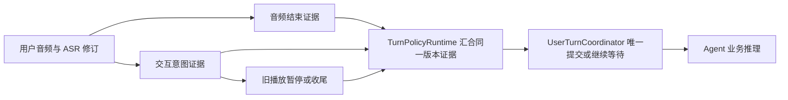

# EOT 优化方案：证据并行，话轮统一提交

日期：2026-10-17。状态：设计建议，尚未修改生产行为。

后续已补充架构级联、真实 LLM、host 资源与 AgentSession 对比。最终取舍、host 配置和未通过项以 [EOT 系统评估与最终建议](eot-system-evaluation-2026-10-17.md) 为准。本文保留早期设计依据；普通轮次的语义判断收敛为同请求暂存推理方向，不默认新增串行分类调用。

依据：[Mac / Pi5 EOT 对比验证](eot-comparison-2026-10-17.md)。

## 决策

保留现有 Channel / LiveKit 架构，在已有话轮协调器上收敛证据与提交职责。先完成输入、预测生命周期和交互意图的契约，再接入一个可替换的音频检测器做影子评测。最终由目标设备上的产品数据决定主模型，不将多个模型长期堆叠投票。

优先保留两个集成候选：

- **LiveKit v1-mini**：真实停顿区分、原生音频流生命周期与 Mac/Pi5 数值一致性有优势，适合作为首个音频影子适配器。其中文片段表现不能忽视，也不能凭集成方便直接成为生产默认。
- **TurnSense 1.0 INT8**：中文片段表现和开放 ONNX 交付有优势，适合作为同接口的替换候选。需要证明在真实自由对话上有收益，不能拿片段 95% 准确率代替产品验收。

Smart Turn 留作轻量基准；TurnSense 1.1 当前增加的资源成本没有换来明确话轮收益；FireRed 保留为生产与回归基线。官方预处理对照未改善结果，不将其直接作为上线修复。

## 逻辑边界

“说完”“交出话轮”“需要回答”“允许执行业务动作”分别有自己的含义。缺少机票目的地时用户也可能已经说完，Agent 应接话澄清；用户说“先别回答”时句子可能完整，但系统应继续等待。

| 事实或判断 | 唯一职责 | 不应承担的职责 |
|---|---|---|
| VAD / 音频 EOT | 有效语音边界、声学结束证据 | 执行业务、直接生成回答 |
| ASR | 当前文本、修订版本与 final 事实 | 宣布整个产品请求已完成 |
| 交互意图判断 | 保持播放、让出声音、停止、等待、需要回应 | 替代业务参数校验和工具授权 |
| TurnPolicyRuntime | 汇总同一候选的证据，决定下一动作 | 私自提交第二个产品话轮 |
| UserTurnCoordinator | 组装文本、保持候选身份、唯一提交/拒绝 | 自己实现另一套音频定时器 |
| OutputController / SDK | 执行暂停、恢复、取消和播放收尾 | 用播放结束事件推断用户请求完成 |
| Agent | 已提交请求的推理、澄清、工具执行和持久化 | 接管毫秒级 VAD/EOT/播放状态机 |

动作原则：

1. 用户发起有效插话时，可以先可逆地暂停声音；停止旧回答所需的意图证据与提交新请求所需的结束证据分开。
2. “不是，我想问的是……”可以使系统让出声音，但新回答要继续等用户表达结束。
3. “先别回答，我还没说完”进入用户持有话轮的等待状态。普通不确定超时不能覆盖这项明确意图；保活/会话结束超时也不能被解释成回答授权。
4. 附和保持当前播放；明确停止终止当前播放，并不自动生成新回答。
5. ASR 修订、继续说话、播放代次变化会使旧证据失效。迟到的模型结果只能丢弃，不能作用于新候选。
6. 模型失败、缺失和 SDK 默认分数保持独立状态。必须有界地退回现有保守时序，不能把错误默认值包装成高置信完成。

## 工程方案

### 1. 复用已有身份与时间轴

扩展现有 candidate / generation / transcript revision 证据记录，至少携带音频截至时刻、文本版本、播放代次、模型版本、推理状态和完成时刻。不要再维护第二套候选 ID、会话音频缓存或提交状态机。

模型权重可以进程共享；音频窗口、ASR 修订、等待状态和预测 future 必须会话隔离。分数只能用于它所观察的版本。

### 2. 推理与交互意图并行，提交前汇合

音频检测器在用户说话时收集输入，在停顿处产生结束证据。文本稳定版本到达后启动或更新交互意图判断；复用现有分类调用，扩展其输出契约，而不是再串行增加一个“完整请求 LLM”。

需要允许回答的候选必须有足够的交互意图证据；不能用音频高分跳过“等待/附和”判断。普通轮次增加语义判断的成本也要计入实测，不能假定免费。先用现有 provider 做影子验证；不按每个音频帧或每个 token 发起模型请求。

当前 `InterruptAwareTurnDetector` 先 settle 再推理。优化目标是允许纯推理提前执行，把“旧播放已正确终止”保留在不可逆提交之前。不得简单删掉 settle，也不得让旧 SpeechHandle 尚未收尾时提前生成新回答。

所有 endpointing 等待沿用最近有效说话结束的时钟锚点；证据计算消耗已经经过的等待预算，不再启动一段新的完整等待。

交互判断使用同一候选的只读上下文快照：当前用户文本、必要的前一轮对话、正在播放的回答以及当前等待状态。上下文由已有会话契约提供，不让检测器访问业务工具或复制 Agent 的完整记忆。明确等待只能由后续有效用户意图或会话结束解除，不能因为普通 EOT 超时自动变成回答许可。

### 3. 按 SDK 支持的生命周期接入

LiveKit 原生音频检测器直接走流式协议。当前文本包装器不能机械套在它外面；集成需要保留 push / predict / cancel / flush / close 和预测作废行为，以及现有 Channel 的提交前约束。

第三方 ONNX 检测器放在 Channel 的插件适配层，调用上游特征提取与推理实现。只补必要的协议转换，不复制模型，不修改安装目录中的 SDK，不另建 EOT HTTP 微服务。若 SDK 缺少需要的公开钩子，先明确最小上游扩展，再接入；不要复制 AudioRecognition 内部实现。

本轮已发现相同权重在 Mac/Pi5 上存在阈值翻转；Smart Turn 的部分差异可由微小前端差异触发，TurnSense 与 FireRed 还存在推理路径差异。因此版本契约必须包含前端和运行时，影子评测必须分别校准目标平台。不能通过随意舍入输入、增加关键词特判或叠加第二模型来掩盖问题。

结束模型不直接调用 `generate_reply`。LiveKit 继续处理音频与 endpointing，现有 completed hook / UserTurnCoordinator 仍是产品请求的唯一正常提交入口。

### 4. 预测性准备单独立项

EOT 判定尚未成立时，可以研究可取消、无外部副作用的准备工作，但它与话轮提交是不同能力。工具执行、长期记忆写入和可听输出必须在提交后。当前不把打开 speculative generation 当作修复 EOT 的捷径。

## 项目边界

| 项目 | 本次优化应落入的内容 |
|---|---|
| `eidolon_channel` | 会话证据、交互意图、插件适配、话轮决策、播放生命周期和语音评测 |
| `eidolon_models` | 选定第三方模型后管理固定版本、权重摘要、输入契约、许可与交付；不持有活动会话 |
| `eidolon_agent` | 提交后的业务理解和回答；必要时通过已有会话契约提供上下文，不新增音频状态机 |
| `eidolon_ops` | 构建、模型与依赖预检、发布、健康检查、回滚；不实现对话判断 |
| `eidolon_sdk` | 保持通用传输契约；不为一次模型选型暴露私有分数或新增产品端点 |
| Mobile / ESP32 客户端 | 真实音频采集、AEC、播放事实与传输；不重复判断完整请求 |
| Hub / Kernel / Data | 维持各自已有权威，EOT 不进入设备身份、授权和数据存储边界 |

LiveKit mini 随其运行时包管理，并遵守其模型许可；不把它作为独立跨框架模型服务，也不用它的输出蒸馏其他候选。第三方 ONNX 权重进入正式交付前需遵循 Models 与 Ops 现有工件约定。

## 实施与验收顺序

1. **收敛契约与可观测性**：固定预测身份、错误状态、时间锚点、等待意图和唯一提交规则；现有回归维持通过。明确哪些预期失败属于真实模型限制，哪些属于未配置分类器的测试夹具。
2. **音频适配器影子运行**：先 LiveKit mini，再用同接口验证 TurnSense 1.0。两端记录相同字段，只记录候选动作，不改变用户正在体验的链路。
3. **冻结真实产品评测集**：覆盖 BOX-3 / Mobile、不同说话人、远近场、播放重叠、ASR 修订、长停顿、短回答、附和、否定修正、引用停止指令、明确等待。按说话人和会话划分，不能在保留集上继续调参。
4. **选择一个生产主模型**：在相同允许抢话水平下比较接话 p50/p95；同时查看误取消、恢复成功率、请求丢失/重复、CPU、RSS、模型超时和实际扬声器停止/开始时间。
5. **完成小范围真实验收后发布**：明确停止不会引发新回答；等待不会被普通超时打破；附和不会销毁旧回答；续说不会丢前缀或产生重复请求。所有候选满足这些约束后才讨论缩短等待。

离线结果支持上述设计方向与候选缩小，尚不构成最终用户体验保证。发布验收必须落到真实 ASR、完整调用链和设备播放；本轮不把纯模型计时或 host `speaking` 事件当作扬声器听感。
